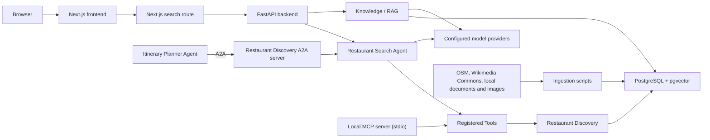

# Restaurant AI RAG

A modular restaurant-discovery application and AI Engineering learning project. It combines a FastAPI backend, a Next.js chat interface, PostgreSQL with pgvector, model-backed retrieval and generation, and separate MCP and A2A integration points.

## What it does

- Searches restaurant records and OSM restaurant metadata.
- Retrieves indexed documents and can generate answers grounded in retrieved passages.
- Searches indexed restaurant photos with OpenCLIP; photo attribution and restaurant association are preserved.
- Exposes restaurant and document capabilities through backend endpoints, an Agent with Tools, and a local MCP server.
- Supports A2A delegation from the Itinerary Planner Agent to the Restaurant Discovery Agent.
- Includes scripts for importing restaurant data, documents, and images.

Search results and indexed data depend on the configured database and the imports performed locally. Model-backed requests require provider configuration and may incur provider charges.

## Architecture at a glance



The backend is a modular monolith: HTTP, Agents, Workflows, MCP, and A2A are distinct entry points that reuse application capabilities where appropriate. See the [backend architecture guide](backend/ARCHITECTURE.md) for the verified module boundaries and detailed process diagrams.

## Repository map

| Path | Purpose |
| --- | --- |
| [`backend/`](backend/) | FastAPI API, application modules, Agents, Tools, Workflows, MCP/A2A servers, ingestion and evaluation scripts. |
| [`frontend/`](frontend/) | Next.js and React interface for restaurant-search chat. |
| [`infrastructure/docker/`](infrastructure/docker/) | PostgreSQL with pgvector, optional Phoenix, and a disposable integration-test database. |

## Run locally

### 1. Start PostgreSQL

Follow the [infrastructure guide](infrastructure/docker/README.md) to configure the local Compose environment and start PostgreSQL with pgvector. The database container does not run application migrations.

### 2. Start the backend

From `backend`, create a virtual environment, install the development requirements, copy `.env.example` to `.env`, and set the database URL and model-provider credentials needed by the features you plan to use. Then apply migrations and start the API:

```powershell
py -m venv .venv
.\.venv\Scripts\python.exe -m pip install -r requirements-dev.txt
if (-not (Test-Path .env)) { Copy-Item .env.example .env }
# Edit .env before starting model-backed requests.
.\.venv\Scripts\python.exe -m alembic upgrade head
.\.venv\Scripts\python.exe -m uvicorn app.main:app --reload
```

The API listens on `http://127.0.0.1:8000`; interactive API documentation is at [`/docs`](http://127.0.0.1:8000/docs). See the [backend README](backend/README.md) for configuration, ingestion, tests, MCP, A2A, and feature-specific instructions.

### 3. Start the frontend

In a separate terminal, from `frontend`:

```powershell
npm ci
if (-not (Test-Path .env.local)) { Copy-Item .env.example .env.local }
npm run dev
```

Open `http://localhost:3000`. The frontend defaults to the backend at `http://127.0.0.1:8000`; configure `BACKEND_API_URL` in `frontend/.env.local` if it runs elsewhere. See the [frontend README](frontend/README.md) for development and production commands.

## Local services

| Service | Default address | Notes |
| --- | --- | --- |
| Next.js frontend | `http://localhost:3000` | Restaurant-search chat UI. |
| FastAPI backend | `http://127.0.0.1:8000` | HTTP API and OpenAPI docs at `/docs`. |
| PostgreSQL | `localhost:5432` | PostgreSQL 16 with pgvector; started through Docker Compose. |
| Restaurant Discovery A2A | `http://127.0.0.1:8001` | Optional standalone local agent server. |
| Itinerary Planner A2A | `http://127.0.0.1:8002` | Optional; delegates to Restaurant Discovery. |
| Phoenix | `http://127.0.0.1:6006` | Optional local tracing collector; see the infrastructure and backend guides. |

The MCP server uses local `stdio` transport and does not listen on an HTTP port. The A2A servers are intended for local development and are not configured for public deployment.

## Checks

From `backend`:

```powershell
.\.venv\Scripts\python.exe -m pytest tests -q
```

From `frontend`:

```powershell
npm run lint
npx tsc --noEmit --incremental false
npm run build
```

The frontend package does not define a separate test script. Some backend evaluations call external model providers; consult the backend guide before running evaluation commands.

## Configuration and data

- Keep credentials in local `.env` files. Do not commit provider API keys or database passwords.
- `backend/.env.example` and `frontend/.env.example` are templates; copy them to local environment files and update values as needed.
- Restaurant, document, and image search depend on what has been imported into the local database.
- OpenCLIP model weights are downloaded when image ingestion or search first requires them.
- Model-backed search, embedding, and answer-generation calls may incur provider charges.

## Project guides

- [Backend setup and feature guide](backend/README.md)
- [Backend architecture and process diagrams](backend/ARCHITECTURE.md)
- [Frontend development guide](frontend/README.md)
- [Docker infrastructure guide](infrastructure/docker/README.md)
