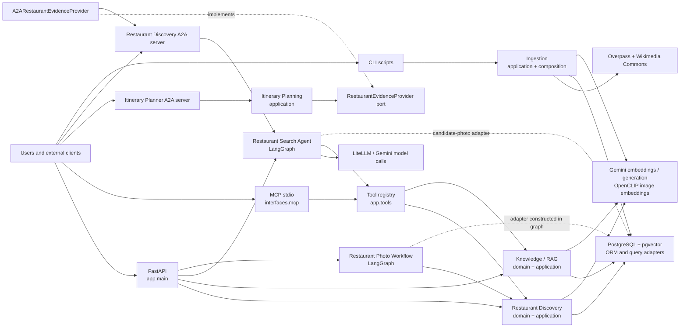
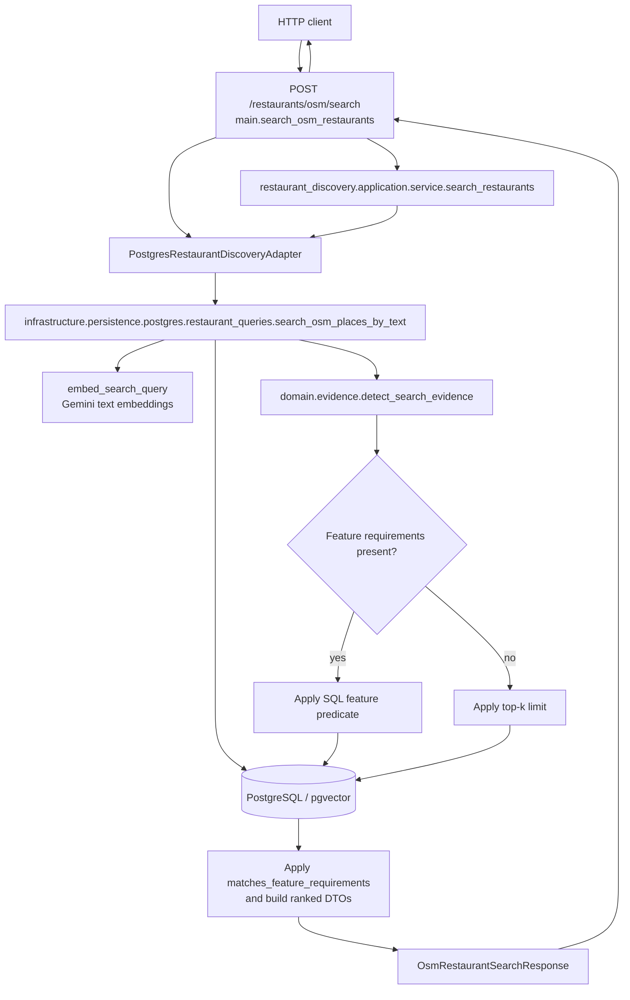
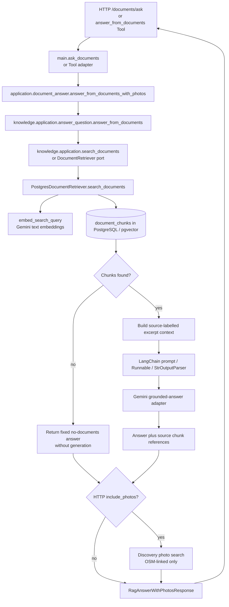
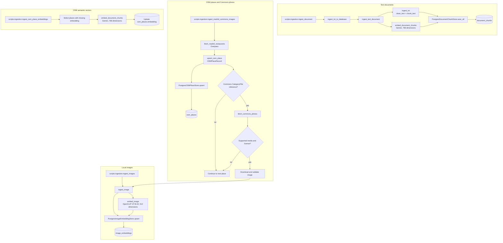

# Backend architecture and file decisions

## Strategic model

The backend is a modular monolith. Contexts own their language and policies;
HTTP, Tools, MCP, A2A, and command-line programs are delivery adapters, not
bounded contexts.

| Context or capability | Responsibility | Relationship |
| --- | --- | --- |
| Restaurant Discovery | Searches OSM places and indexed restaurant imagery; applies supported feature evidence, freshness, corpus, and photo-association rules. | Supplies ranked candidates and evidence to Tools, Agents, workflows, and HTTP. |
| Knowledge | Prepares and retrieves indexed documents and generates answers grounded in retrieved excerpts. | Receives document chunks from ingestion; uses PostgreSQL retrieval and a Gemini generation adapter. |
| Ingestion | Coordinates text, image, and OSM indexing flows while retaining their existing transaction and provenance behavior. | Writes to the Knowledge or Restaurant Discovery stores; filesystem, embeddings, OSM, and Commons remain technical adapters. |
| Agent orchestration | Runs the Restaurant Search Agent's model/tool cycle. | Normal model-selected calls go through the Tool registry. Candidate-scoped photo search also calls the Discovery application service directly; the Agent does not reimplement association policy. |
| Photo workflow | Runs the LangGraph candidate/photo sequence. | Calls Discovery application behavior and constructs the PostgreSQL adapter in its graph nodes. |
| Itinerary dining planning | Produces the current ranked-candidate draft for requested days. | Consumes restaurant discovery over the A2A boundary; it does not promise route feasibility, opening hours, availability, or reservations. |
| Shared infrastructure | SQLAlchemy sessions/ORM, PostgreSQL/pgvector, Gemini and CLIP embeddings, LiteLLM routing, tracing, and external-data clients. | Technical capabilities shared by contexts; not a domain or shared domain model. |
| Delivery interfaces | FastAPI, Tools, MCP, A2A, and CLI entry points. | Validate/translate public contracts and compose application dependencies. |

The main context relationships are:

- Ingestion writes data consumed by Knowledge and Restaurant Discovery.
- Agents and workflows reuse application capabilities rather than duplicating
  search, evidence, or attribution policies. The Agent and photo Workflow
  currently construct PostgreSQL adapters in orchestration code; see the flow
  notes below.
- Itinerary planning consumes Restaurant Discovery through the existing A2A
  protocol adapter.
- FastAPI, Tools, MCP, and A2A expose capabilities while preserving their
  current public schemas and artifact names.

## Runtime architecture and module responsibilities

The project is a modular monolith: functional contexts own their contracts and
policies, while delivery protocols and technical providers remain transversal.
The diagram shows the implemented dependency paths, including the two places
where Agent/Workflow orchestration currently constructs a PostgreSQL adapter.



| Module | Responsibility observed in code |
| --- | --- |
| `restaurant_discovery/domain` | Evidence requirements, query intent, OSM feature labels, photo identity, and search-embedding freshness policies. |
| `restaurant_discovery/application` | Discovery operations and the `RestaurantDiscoveryPort` contract; does not issue SQL. |
| `knowledge/domain` and `knowledge/application` | Text preparation policy, document-search/RAG contracts, retrieval coordination, and grounded-answer orchestration. |
| `itinerary_planning/application` | Validates requests and builds a deterministic dining draft from evidence supplied through `RestaurantEvidenceProvider`. |
| `ingestion/application` | Coordinates document, image, and OSM updates through typed ports. `ingestion/composition.py` connects providers and stores. |
| `application` | Cross-context use cases: document answers with optional photos and the restaurant catalog. `ports.py` and `restaurant_discovery.py` are compatibility exports retained by tests. |
| `infrastructure` and `models` | SQLAlchemy/pgvector queries and persistence, Gemini and OpenCLIP adapters, filesystem and external-data clients, model routing, configuration, and ORM records. |
| `interfaces` | HTTP, MCP, and A2A request/response translation and process composition. |
| `tools` | Model-facing, validated capabilities. The registry dispatches to the existing Discovery and Knowledge operations. |
| `agents` and `workflows` | LangGraph orchestration. The Agent uses Tools for regular model-selected calls; the photo workflow invokes Discovery use cases directly. |

### Implemented process flows

The diagrams describe code paths, not a claim that every provider or database
operation was exercised live. The recent real-process A2A check and its
observability limitation are recorded in the [README](./README.md).

#### 1. Restaurant search



`main.search_osm_restaurants` supplies the database-backed adapter. The query
adapter obtains a Gemini query embedding, applies supported feature and exact
filter predicates, orders candidates by pgvector distance, and returns the
Discovery response contract. The Tool and MCP entrypoints reuse the same
application service through their adapters.

#### 2. Restaurant search through the Agent and Tools

```mermaid
flowchart TD
  caller[HTTP /agents/restaurant-search<br/>or A2A Discovery task] --> agent[run_restaurant_search_agent]
  agent --> graph[LangGraph model/tool cycle]
  graph --> model[LiteLLM router<br/>configured chat model]
  model --> decision{Model returned Tool calls?}
  decision -->|no| final[Build RestaurantSearchAgentResponse]
  decision -->|yes| dispatch[tools.registry.dispatch_tool_call]
  dispatch --> validate[Validate Tool name and input schema]
  validate --> handler[Tool adapter]
  handler --> usecase[Discovery or Knowledge application operation]
  usecase --> persistence[PostgreSQL adapter and query]
  persistence --> database[(PostgreSQL / pgvector)]
  database --> result[Serialized Tool result]
  result --> graph
  graph -->|continue until answer or turn limit| model
  graph -. when candidate photos are requested .-> scoped[_search_candidate_photo_tool]
  scoped --> association[search_verified_candidate_photos]
  association --> directAdapter[PostgresRestaurantDiscoveryAdapter]
  directAdapter --> database
  association --> result
  final --> caller
```

The A2A Discovery server adapts a text message into the same Agent call and
wraps its result as the `restaurant_discovery_result` JSON artifact. Regular
Tool calls go through the registry; candidate-scoped photo handling is a
separate Agent path, but delegates association and search behavior to the
Discovery application service.

#### 3. Document retrieval and RAG answer generation



The MCP `answer_from_documents` Tool uses the same Knowledge answer use case
without the HTTP-only optional photo composition. Retrieved chunks are the
generation context; when no chunks are found, the application returns its
fixed no-documents answer. HTTP may separately request indexed OSM-linked
photos for the question.

#### 4. Candidate-scoped photo Workflow

```mermaid
flowchart TD
  caller[HTTP /workflows/restaurant-photo-search] --> run[run_restaurant_photo_workflow]
  run --> graph[LangGraph StateGraph]
  graph --> candidates[search_candidates]
  candidates --> service[Discovery search_restaurants]
  service --> adapter[PostgresRestaurantDiscoveryAdapter]
  adapter --> db[(PostgreSQL / pgvector)]
  db --> branch{Candidates returned?}
  branch -->|no| compose[compose_response]
  branch -->|yes| photos[search_photos_for_candidates]
  photos --> verified[Discovery search_verified_candidate_photos]
  verified --> each[For each bounded candidate:<br/>candidate-scoped photo search]
  each --> imageAdapter[PostgresRestaurantDiscoveryAdapter]
  imageAdapter --> imageQuery[search_images_by_text<br/>CLIP text embedding + PostgreSQL]
  imageQuery --> association[Require exact non-empty OSM source URL match<br/>deduplicate photo sources]
  association --> compose
  compose --> response[RestaurantPhotoWorkflowResponse]
  response --> caller
```

The graph skips photo retrieval when candidate search returns no candidates.
For matches, `search_verified_candidate_photos` scopes the lookup to each OSM
place and applies the domain source-URL association rule before
`compose_response` groups photos with candidates. Adapter construction
currently occurs in the Workflow nodes.

#### 5. Ingestion and indexing



`ingest_document` chunks and embeds text before the PostgreSQL store persists
records. `ingest_images` embeds local images with CLIP. The Madrid importer
fetches OSM data and only looks up Commons photos when the OSM record supplies
a supported `Category:` or `File:` reference; accepted images retain source,
license, attribution, and place association. OSM place vectors are populated
by the separate resumable `ingest_osm_place_embeddings` command.

#### 6. A2A delegation between Discovery and Itinerary Planning

```mermaid
sequenceDiagram
  participant Client as External A2A client
  participant Planner as Itinerary Planner :8002
  participant PlanApp as plan_itinerary_dining
  participant Provider as A2ARestaurantEvidenceProvider
  participant Discovery as Restaurant Discovery :8001
  participant Agent as Restaurant Search Agent
  participant Store as PostgreSQL / pgvector

  Client->>Planner: Discover Agent Card; send JSON query + day_count
  Planner->>PlanApp: Validate request and invoke
  PlanApp->>Provider: search_restaurants(query)
  Provider->>Discovery: Discover Agent Card; send text task via JSON-RPC
  Discovery->>Agent: Validate task and run existing Agent
  Agent->>Store: Tool-backed retrieval (Gemini embeddings and SQL)
  Store-->>Agent: Ranked candidate evidence
  Agent-->>Discovery: RestaurantSearchAgentResponse
  Discovery-->>Provider: restaurant_discovery_result JSON artifact
  Provider->>Provider: Validate artifact; map to RestaurantSearchEvidence
  Provider-->>PlanApp: Return structured restaurant evidence
  PlanApp->>PlanApp: Build days, alternatives, and unfilled count
  PlanApp-->>Planner: ItineraryDiningDraft
  Planner-->>Client: itinerary_dining_draft JSON artifact
```

This service-to-service path is distinct from direct HTTP, MCP, and Agent Tool
calls. Itinerary Planning depends on its evidence-provider port; the A2A
adapter implements it and is injected when the Planner server is composed.

## How to read the boundaries

- **Domain** holds pure rules: Discovery owns search-evidence and photo
  association policies; Knowledge owns text preparation. The shared
  `app/domain` root was removed because its Discovery re-export modules had no
  repository callers, and its remaining OSM embedding invalidation rule belongs
  to Discovery.
- **Application** coordinates use cases and declares the capabilities they
  need. Context modules own their own ports; `app/application` remains for the
  cross-context document-answer/photo flow and restaurant catalog. Its old
  Discovery exports remain because tests explicitly protect those import paths.
- **Infrastructure** implements persistence and external-provider behavior.
  ORM models are storage records, not domain aggregates. PostgreSQL/pgvector
  query builders and ranking remain infrastructure concerns.
- **Interfaces** adapt HTTP, MCP, and A2A messages and compose runtime
  dependencies. They are separate delivery mechanisms; MCP and HTTP do not
  need A2A to call local capabilities.
- **Tool** is a validated, model-callable capability dispatched by
  `app.tools.registry`; it is not an autonomous agent. The **Agent** runs a
  model/tool cycle and returns a structured response. The **Workflow** runs a
  state graph with explicit candidate-search, photo-search, and response
  composition steps. Both reuse Discovery policies rather than reimplementing
  them.
- **A2A** is used when the separately hosted Itinerary Planner delegates
  restaurant discovery to the separately hosted Discovery Agent. Direct
  endpoint, Tool, MCP, and Workflow use cases remain in-process.

One coupling is real but does not duplicate a business rule: the Agent's
candidate-scoped photo path and the photo Workflow construct
`PostgresRestaurantDiscoveryAdapter` in orchestration code. If persistence
substitution or isolated Agent/Workflow execution becomes a concrete need,
adapter construction could move to their composition entrypoints; the current
code instead keeps the existing application service and association rule.

## Verification boundaries

- The code and tests establish the in-memory A2A protocol path. The README
  records a separate live-process A2A request; that check confirmed the task
  response, but Phoenix export to `127.0.0.1:6006` failed because no collector
  was listening.
- The diagrams show implemented provider calls. They do not claim that
  Overpass, Wikimedia Commons, Gemini, CLIP model downloads, PostgreSQL
  integration tests, or all runtime combinations were exercised during this
  documentation and consolidation task.
- Architecture tests statically inspect imports and selected composition
  boundaries; static checks cannot prove the absence of dynamic imports.

## Tactical DDD decisions

Use DDD only where code demonstrates a domain rule:

- Restaurant feature requirements, evidence status, kosher freshness, query
  intent, and photo association are policies in
  `app.restaurant_discovery.domain`.
- Candidate/photo association requires exact equality of non-empty OSM source
  URLs. Names, filenames, and similarity are not substitutes for identity.
- Knowledge text normalization and chunking are pure content-preparation
  policies; the retrieval ranking remains an infrastructure concern.
- Existing request/response schemas are DTOs. `OsmPlace`, `ImageEmbedding`,
  and `DocumentChunk` are ORM persistence records, not aggregates.
- No current behavior justifies a generic Restaurant aggregate, a
  recommendation aggregate, or a confidence value around similarity. The
  itinerary flow does not currently implement enough feasibility rules to
  justify an itinerary aggregate.

## Naming and module placement

These conventions apply to new modules and to files that must change for a
functional reason. They are not a mandate to rename stable modules solely for
style.

### Names

- Use `snake_case` for Python module and test filenames. Name types and
  functions with the terms used by their bounded context, not infrastructure
  jargon leaking into the domain.
- Prefer a concrete responsibility over a generic category. Use action names
  for use cases (`search_documents.py`, `answer_question.py`); name ports for
  the capability the use case needs (`DocumentRetriever`,
  `GroundedAnswerGenerator`); name adapters for their role and, when useful,
  their technology (`PostgresDocumentRetriever`).
- Use `Request`, `Response`, or `DTO` in transport/application contract type
  names when that distinction helps callers. Keep transport contracts distinct
  from domain concepts and SQLAlchemy records. ORM records belong under
  `app.models`; a same-named domain concept should live in its context's
  `domain/` package. Add a `Record` suffix only when package context does not
  make an actual name collision clear.
- Do not add `_service`, `_manager`, `_handler`, or `_repository` as automatic
  suffixes. Use a pattern suffix only when the code actually implements that
  pattern and the suffix clarifies responsibility.
- Avoid unscoped names such as `manager.py`, `helper.py`, `common.py`, or
  `utils.py`. A conventional or idiomatic exception is acceptable when its
  package bounds the responsibility (`ports.py` for a small cohesive set of
  ports, or SQLAlchemy's `models/base.py` for its declarative `Base`). Split a
  growing generic file by capability instead of accumulating unrelated code.

### Placement and dependency direction

- Start with the bounded context, then choose the narrowest layer that owns
  the responsibility. Do not create empty `domain/`, `application/`, or
  `infrastructure/` packages just to make contexts look uniform.
- Keep domain rules independent of FastAPI, SQLAlchemy, LLM providers, and
  external protocols. Application use cases coordinate domain behavior and
  declare the ports they need. Infrastructure implements those ports.
  Interfaces translate HTTP, MCP, A2A, CLI, or other input/output contracts;
  they do not become alternate homes for domain rules.
- Put technology-specific code under infrastructure or the appropriate
  interface. Avoid adding global `common` or `shared` packages unless a real
  cross-context capability is demonstrated.
- Before adding, moving, splitting, renaming, or deleting a file, inspect its
  responsibility and equivalents, search imports and runtime entry points,
  check public contracts, and identify affected tests, scripts, configuration,
  and documentation. Update callers together; keep a compatibility re-export
  only when actual consumers or a documented entry point justify it.
- Preserve HTTP, Tools, MCP, and A2A contracts, Alembic history and database
  schema, and protected retrieval behavior during organizational changes.

### Verified examples and proposed naming

The following are existing examples in this repository, not newly proposed
files:

- `app.knowledge.application.search_documents` and
  `app.knowledge.application.answer_question` express actions in Knowledge.
- `DocumentRetriever` and `GroundedAnswerGenerator` in
  `app.knowledge.application.ports` describe application capabilities;
  `PostgresDocumentRetriever` in
  `app.knowledge.infrastructure.postgres.retriever` implements retrieval.
- `FeatureRequirement` and `SearchEvidenceRequest` in
  `app.restaurant_discovery.domain.evidence` are domain concepts, while
  `app.models.osm_place.OsmPlace` is a SQLAlchemy record, not a domain entity.
- `DocumentSearchRequest`, `OsmRestaurantSearchResponse`, and the A2A/MCP
  schemas distinguish transport contracts; tests use the `test_` prefix and
  name the behavior they cover.
- `app.restaurant_discovery.application.service` and
  `app.models.base` are existing scoped/idiomatic exceptions to avoiding
  generic filenames. Do not mechanically rename them; use more specific names
  for new files when that improves discoverability.

For future files, `search_restaurants.py` is a proposed action-oriented module
name when it owns that use case; it does not imply that another implementation
should be added if the behavior already exists.

The tests under `tests/architecture/` protect the dependency-free domains in
Restaurant Discovery and Knowledge, statically check the `app.*` import graph
for cycles, and prevent `main.py` from importing ORM models or SQL query
builders. Static checks do not detect dynamic imports.

## Current backend tree

```text
backend/
├── app/
│   ├── agents/                         # model/tool orchestration
│   ├── application/                    # cross-context application services and DTOs
│   ├── core/                           # environment configuration
│   ├── infrastructure/
│   │   ├── embeddings/                 # Gemini and OpenCLIP adapters
│   │   ├── external_data/              # Overpass and Wikimedia Commons clients
│   │   ├── filesystem/                 # document file adapter
│   │   ├── llm/                        # shared model routing
│   │   ├── persistence/postgres/       # sessions, ORM queries, and persistence adapters
│   │   └── observability.py            # OpenTelemetry/Phoenix helpers
│   ├── ingestion/                      # ingestion use cases and composition
│   ├── interfaces/
│   │   ├── a2a/                        # A2A servers and protocol clients
│   │   ├── http/                       # HTTP schema aggregation
│   │   └── mcp/                        # MCP server and public tool schemas
│   ├── itinerary_planning/             # itinerary application service and A2A client
│   ├── knowledge/                      # Knowledge/RAG context
│   ├── models/                         # SQLAlchemy ORM records
│   ├── presentation/                   # shared response presentation helpers
│   ├── restaurant_discovery/           # restaurant discovery bounded context
│   ├── tools/                          # model-facing Tool adapters/registry
│   ├── workflows/                      # LangGraph workflow adapters
│   ├── main.py                         # stable FastAPI ASGI composition entry point
│   └── schemas.py                      # legacy schema re-exports
├── alembic/                            # migration history; unchanged
├── data/                               # corpus and evaluation fixtures
├── evaluation/                         # shared offline evaluation utilities
├── scripts/
│   ├── a2a/                            # A2A client commands
│   ├── diagnostics/                    # operational diagnostics
│   ├── evaluation/                     # offline evaluator commands
│   ├── ingestion/                      # data import commands
│   └── maintenance/                    # audit/report commands
├── static/                             # backend-served static page
├── tests/
│   ├── architecture/                   # architectural boundary checks
│   ├── contracts/                      # HTTP, Tools, MCP, and A2A contracts
│   ├── evaluation/                     # evaluator and dataset tests
│   ├── integration/                    # opt-in PostgreSQL/pgvector tests
│   └── unit/                           # domain, application, context, and adapter tests
├── alembic.ini, pytest.ini             # tool-discovered configuration
└── requirements*.txt, README.md        # environment and operations documentation
```

Only stable composition/configuration entry points remain at package roots.
Operational commands are grouped by purpose under `scripts/`; cross-cutting
technical adapters live under `app/infrastructure/`; external protocols live
under `app/interfaces/`. `app.schemas` is retained only as a compatibility
re-export while the canonical public schema aggregation lives in
`app.interfaces.http.schemas`.

The three basic catalog endpoints use the `RestaurantCatalog` application
port. `main.py` constructs `PostgresRestaurantCatalog` through a FastAPI
dependency; ORM queries, commit/refresh, and OSM response mapping are in the
PostgreSQL adapter. This keeps the HTTP handlers focused on schemas, status
codes, and dependency wiring without inventing a catalog aggregate where no
business invariant currently exists.

| Package files | Responsibility / decision |
| --- | --- |
| `app/restaurant_discovery/domain/osm_place.py` | The pure policy for deciding whether searchable place metadata changed lives with the Discovery context whose embedding it invalidates. The unreferenced global `app/domain/restaurant_discovery` re-export package was removed; `app/application/{ports.py,restaurant_discovery.py}` remain compatibility exports covered by tests. |
| `app/application/{__init__.py,document_answer.py,restaurant_catalog.py}` | Keep cross-context answer composition and catalog application contracts/use cases; ORM access remains in PostgreSQL adapters. |
| `app/restaurant_discovery/{domain/{evidence.py,osm_features.py,osm_place.py,photo_association.py,query_intent.py},application/{contracts.py,coverage_audit.py,ports.py,service.py},infrastructure/postgres.py}` | Canonical Restaurant Discovery context: pure evidence, OSM feature labels, searchable-metadata invalidation, and identity rules; application orchestration and coverage reporting; and a PostgreSQL adapter. Validate use cases, ingestion, Tools, Agent, workflow, query, and API regressions. |
| `app/infrastructure/{embeddings,external_data,filesystem,llm,persistence/postgres,observability.py}` | Keep technical providers and adapters out of the `app/` package root. SQL/pgvector retrieval and query semantics are unchanged; validate adapter and embedding tests plus the opt-in PostgreSQL suite. |
| `app/knowledge/{__init__.py,domain/__init__.py,domain/text.py,application/__init__.py,application/contracts.py,application/ports.py,application/answer_question.py,application/search_documents.py,infrastructure/__init__.py,infrastructure/postgres/__init__.py,infrastructure/postgres/retriever.py,infrastructure/generation/__init__.py,infrastructure/generation/answer_chain.py}` | Keep the context-first structure; it owns document-search/RAG contracts and separates text policy, retrieval/answer use cases, database retrieval, and Gemini/LangChain generation. Validate with RAG/retrieval tests using mocks. |
| `app/ingestion/{__init__.py,composition.py,application/{__init__.py,ports.py,documents_usecase.py,images_usecase.py,osm.py}}` | Keep; application use cases depend on ports, while composition translates provider DTOs and wires filesystem/embedding providers and PostgreSQL adapters. `application/{documents.py,images.py}` remain compatibility facades; `application/osm.py` is the OSM upsert use case. Validate with use-case, transaction, ingestion, and compatibility tests. |
| `app/models/{__init__.py,base.py,restaurant.py,osm_place.py,image_embedding.py,document_chunk.py}` | Keep as ORM persistence records. `alembic/env.py` imports `app.models` so all tables remain registered. Validate metadata imports and Alembic history. |
| `app/agents/{__init__.py,schemas.py,restaurant_search_agent.py}` | Keep public Agent schemas unchanged. `restaurant_search_agent.py` remains the LangGraph/model/tool orchestration boundary; registry Tool calls use existing application operations, while candidate-scoped photo search calls the Discovery application service directly and constructs its PostgreSQL adapter in the Agent path. |
| `app/workflows/{__init__.py,schemas.py,restaurant_photo_search.py}` | Keep workflow DTOs and graph boundary. The photo workflow coordinates Discovery application operations and scoped image lookup; it constructs the PostgreSQL adapter in graph nodes and reuses the exact source-URL domain policy. |
| `app/tools/{__init__.py,registry.py,restaurant_search.py,restaurant_photos.py,document_search.py,document_answer.py}` | Keep the registry and thin adapters. MCP and the model Agent share names, input schemas, hidden arguments, result serialization, and stable error categories. |
| `app/interfaces/{http,mcp,a2a}` | Group protocol-specific schemas, servers, and clients by delivery mechanism. Keep endpoint paths, MCP tool schemas, A2A agent cards, artifacts, and task behavior unchanged. |
| `app/itinerary_planning/{application,infrastructure/a2a}` | Keep the deterministic itinerary-draft use case separate from the A2A client adapter. It remains a small application capability, not an artificial domain aggregate. |
| `app/presentation/image_urls.py` | Keep safe local-image URL mapping out of the package root; preserve the existing response URL format. |
| `app/main.py` | Keep the stable ASGI entry point and explicit FastAPI composition. Launch remains `uvicorn app.main:app`; no public route or response contract changes. |
| `app/schemas.py` | Keep temporarily as a compatibility re-export; canonical aggregation is in `app/interfaces/http/schemas.py`, while application DTO definitions live with their application services. |

Ingestion document/image/OSM use cases depend on typed application ports, while
the composition module wires filesystem, embedding, external-data, and
PostgreSQL adapters. Its OSM composition translates the Overpass DTO into an
application `OSMPlaceRecord`; persistence applies the Discovery-owned
searchable-metadata invalidation policy. Provider DTOs and shared schema
contracts remain at their current integration boundaries; changing those
contracts would require preserving CLI and external integrations.

## `backend/app/` root module decisions

| Current file or group | Responsibility / category | Decision | Reason and validation |
| --- | --- | --- | --- |
| `__init__.py` | Python package marker | Keep | Required package path; no behavior. |
| `main.py` | FastAPI ASGI entry point, routes, and explicit dependency composition | Keep as the stable ASGI entry point; catalog endpoints inject the application port and delegate. | `uvicorn app.main:app`, API tests, and `get_db` overrides depend on it. Validate `test_api.py`; route paths, response models, ordering, and status codes remain unchanged. |
| `a2a_server.py`, `itinerary_planner_server.py`, `itinerary_planner_client.py`, `itinerary_planner_agent_client.py` | A2A server/client adapters | Keep as protocol/import entry points. | Agent cards, artifact names, JSON parts, and client imports are contracts; validate with the four A2A test modules. |
| `mcp_server.py`, `mcp_schemas.py` | MCP delivery adapter and public MCP DTOs | Keep as protocol/import entry points. | Stdio launch and public schemas are compatibility boundaries; validate with `test_mcp_server.py`. |
| `schemas.py` | Remaining shared FastAPI/Tool request and response DTOs | Keep as a compatibility aggregator; Discovery contracts are owned by `restaurant_discovery.application.contracts`, Knowledge search/answer contracts by `knowledge.application.contracts`, and both are re-exported here. | Preserves existing schema import paths and class identity while establishing context ownership. Validate API, Tool, MCP, and Agent contracts. |
| `restaurant_search.py`, `image_search.py` | Legacy search import paths | Keep as compatibility facades; SQL/pgvector implementations are in `infrastructure/persistence/postgres/restaurant_queries.py` and `image_queries.py`. | Retains existing callers while making PostgreSQL infrastructure own the queries. Validate discovery, image pipeline, and PostgreSQL query tests. |
| `document_ingestion.py`, `image_ingestion.py`, `osm_ingestion.py` | Legacy ingestion import paths | Keep as stable facades into `app.ingestion`; composition wires provider-independent use cases to PostgreSQL adapters. | Existing CLI and test imports continue to work. Validate document/image/OSM ingestion and compatibility tests. |
| `coverage_audit.py` | Aggregation for an operational coverage report | Keep for now as a shared audit helper. | The report consumes ORM-shaped records and OSM feature labels; splitting it from the CLI is not needed to establish a business aggregate. Validate with `test_coverage_audit.py`. |
| `database.py` | SQLAlchemy engine, session factory, FastAPI session dependency | Keep as explicit shared composition infrastructure. | Alembic, FastAPI, MCP, A2A, and tests rely on the same session factory; moving it would add compatibility wrappers without changing the boundary. Validate imports, API/MCP/A2A tests, and Alembic. |
| `embeddings.py`, `image_embeddings.py` | Gemini text and OpenCLIP provider adapters | Keep as shared provider modules for now. | Multiple ingestion/search contexts use them. Preserve model IDs, prefixes, 768/512 dimensions, normalization, and retry behavior; validate embedding and image-pipeline tests. |
| `open_data_sources.py` | Overpass and Wikimedia Commons clients, parsing, and provenance/license checks | Keep as the shared external-data adapter import path. | Ingestion scripts and tests depend on it; moving it is unnecessary for the new ingestion use-case boundary. Validate `test_open_data_sources.py` and offline ingestion tests. |
| `model_routing.py` | LiteLLM model/provider routing | Keep as the current provider adapter used by the discovery Agent. | It is an infrastructure capability, not discovery domain logic; validate `test_model_routing.py` and Agent tests with mocks. |
| `observability.py` | OpenTelemetry/Phoenix and LangSmith tracing helpers | Keep as shared cross-cutting infrastructure. | Several contexts use the same trace policy; validate observability and RAG tests without starting an exporter. |
| `place_filters.py` | Search filter helpers | Keep at the compatibility boundary pending a dedicated import migration. | Query semantics must remain identical; validate restaurant inclusion and PostgreSQL query tests. |
| `image_presentation.py` | Converts local image paths to safe API-relative URLs | Keep as a small presentation helper. | It is used at delivery boundaries and does not belong in the domain; validate API, Tools, and MCP output contracts. |
| `itinerary_planner.py` | Itinerary dining draft application flow | Keep at its stable import path; do not model an aggregate without additional rules. | A2A server/client and tests depend on this module; validate itinerary planner tests. |
| `core/{__init__.py,config.py}` | Environment settings and secrets | Keep under `core/`. | Shared configuration and test setup depend on it; no domain imports should reach it. |

`app/application/restaurant_catalog.py` defines the small catalog port and
application operations for create/list; it contains no SQL or ORM types.
`app/infrastructure/persistence/postgres/restaurant_catalog.py` owns the
corresponding SQLAlchemy queries, transaction behavior, and ORM-to-response
mapping. No schema, table, or migration changed.

## Backend-root files, configuration, and data

| Current file or group | Decision | Reason / validation |
| --- | --- | --- |
| `.env.example` | Keep in `backend/` | Conventionally discovered environment template; must contain placeholders only. |
| `alembic.ini`, `alembic/env.py`, `alembic/README`, `alembic/script.py.mako`, and every file in `alembic/versions/` | Keep in place; do not rename revisions. | Alembic convention and immutable migration history. Validate `python -m alembic heads` and use a disposable database for upgrades. Current head: `c80d3f91a642`. |
| `pytest.ini` | Keep in `backend/`; constrain discovery to `tests` and exclude integration tests by default. | Keeps pytest focused on categorized test modules and prevents accidental PostgreSQL integration runs. Explicit `-m integration` remains available. |
| `requirements.txt`, `requirements-dev.txt` | Keep | Deployment/environment tooling expects these paths. Pylance import analysis found no unresolved top-level imports. |
| `README.md` | Keep | Backend operational commands and protocol/evaluation documentation. Update when a documented path changes. |
| `scripts/{evaluation,ingestion,maintenance,a2a,diagnostics}/` | Group executable commands by purpose; invoke them with `python -m scripts.<group>.<command>`. | Direct file commands were replaced and README selectors updated. Validate `--help`; do not run benchmarks, network/model ingestion, or database operations as architectural checks. |
| `evaluation/utils.py` | Keep shared offline evaluation fingerprint/report helpers outside the CLI package. | Evaluators import it as `evaluation.utils`; validate utility tests and evaluator `--help`. |
| `data/samples/menu.txt` | Move the sample document into data. | A sample corpus file is data, not backend application configuration. Its contents are unchanged; no code or docs depended on the old root path. |
| `static/index.html` | Keep under `static/`. | Runtime asset served by FastAPI; validate the corresponding API/static behavior if changed. |
| `data/evaluation/`, `data/image_evaluation/`, `data/restaurant_evaluation/`, and `data/images/` | Keep as corpus/evaluation assets. | Evaluators and persisted image paths rely on these locations; no corpus or benchmark was changed or run. |
| `infrastructure/docker/docker-compose*.yml`, `init-db.sql`, and `README.md` | Keep in the repository infrastructure tree. | Docker Compose and documented PostgreSQL/Phoenix operations depend on these paths. No services were started for this audit. |
| `docs/ROADMAP.md` | Keep under project docs, unchanged. | It is ignored by the existing `docs/` Git rule; do not silently change ignore behavior as part of backend organization. |
| Local `.env` files, virtual environments, caches, bytecode, and downloaded images | Keep local/untracked; do not inventory as source or move. | May contain secrets or generated data. No secret values were read. |

## Test inventory and organization decisions

`tests/conftest.py` stays at the test root because it supplies shared fixtures.
Tests are grouped by their primary responsibility; existing test functions,
fixtures, and markers are preserved. README selectors are updated to the new
paths, while `testpaths = tests` continues to discover the complete tree.

| Group / files | Category | Decision / risk |
| --- | --- | --- |
| `tests/conftest.py` | Shared SQLite and FastAPI fixtures | Keep at root; changing the global dependency override risks every API test. |
| `tests/architecture/*.py` | Architecture | Keep in `architecture/`; enforce dependency direction, context application independence, domain purity, and HTTP composition. |
| `tests/integration/{conftest.py,test_postgres_queries.py}` | PostgreSQL/pgvector integration | Keep opt-in; requires guarded `POSTGRES_TEST_DATABASE_URL`, migrations, and pgvector. |
| `tests/unit/domain/{test_domain_policies.py,test_search_evidence.py,test_text_processing.py}` | Pure evidence, freshness, and text policies | Keep separate from infrastructure and delivery contracts. |
| `tests/unit/application/test_application_use_cases.py` | Application orchestration | Keeps cross-context use-case tests together. |
| `tests/unit/contexts/discovery/{test_image_pipeline.py,test_restaurant_discovery_postgres_adapter.py,test_restaurant_discovery_query_intent.py,test_restaurant_photo_workflow.py,test_restaurant_search_agent.py,test_restaurant_search_inclusion.py}` | Restaurant Discovery and image retrieval behavior | Protects ranking/filter regressions, policies, adapter telemetry, orchestration, and evidence behavior. |
| `tests/unit/contexts/ingestion/{test_document_ingestion.py,test_ingestion_compatibility.py,test_ingestion_postgres_adapters.py,test_ingestion_use_cases.py,test_open_data_sources.py,test_osm_ingestion.py}` | Ingestion behavior | Protects provider-independent flows, provenance, adapters, and legacy imports. |
| `tests/unit/contexts/knowledge/{test_document_search.py,test_rag.py}` | Knowledge/RAG behavior | Protects retrieval/answer formats, sources, and no-document behavior. |
| `tests/unit/contexts/planning/test_itinerary_planner.py` | Itinerary planning policy | Synthetic candidates only; no agent or provider calls. |
| `tests/unit/infrastructure/{test_coverage_audit.py,test_embeddings.py,test_model_routing.py,test_observability.py}` | Shared provider, observability, and report behavior | Provider calls remain mocked; no live traces or benchmarks. |
| `tests/contracts/http/test_api.py` | HTTP contract | Preserve route schemas and status/error behavior. |
| `tests/contracts/tools/{test_restaurant_search_tool.py,test_retrieval_tools.py}` | Tool contract | Preserve tool argument validation, visibility, and output behavior. |
| `tests/contracts/mcp/test_mcp_server.py` | MCP contract | Preserve stdio tool schemas, output, and sanitized errors. |
| `tests/contracts/a2a/{test_a2a_server.py,test_itinerary_planner_agent_client.py,test_itinerary_planner_client.py,test_itinerary_planner_server.py}` | A2A protocol contract | Preserve Agent Cards, artifacts, task lifecycle, and sanitized errors. |
| `tests/evaluation/{test_evaluation_data.py,test_evaluation_utils.py,test_image_evaluation.py,test_rag_evaluation.py,test_restaurant_evaluation.py}` | Evaluation datasets, helper, and metric tests | Do not invoke live benchmarks as routine validation. |

`pytest.ini` sets `testpaths = tests`; operational scripts live outside the
test tree and cannot be imported by ordinary discovery. The default marker excludes
integration tests; `pytest tests/integration -m integration` explicitly selects
them. The integration fixture must only be pointed at a disposable test
database.

No project CI workflow or coverage threshold configuration was present in the
audited tree, so there were no CI paths or coverage settings to migrate.

## Validation baseline

From `backend/`:

```powershell
.\.venv\Scripts\python.exe -m pytest -q
.\.venv\Scripts\python.exe -m pytest tests\integration -m integration --collect-only -q
.\.venv\Scripts\python.exe -m alembic heads
```

The first command uses mocks and the in-memory SQLite fixtures. The integration
collection command does not run SQL; executing the integration tests requires
an explicitly configured isolated PostgreSQL/pgvector service. Do not invoke
Gemini, download external data, or run evaluation benchmarks during an
architectural reorganization.
